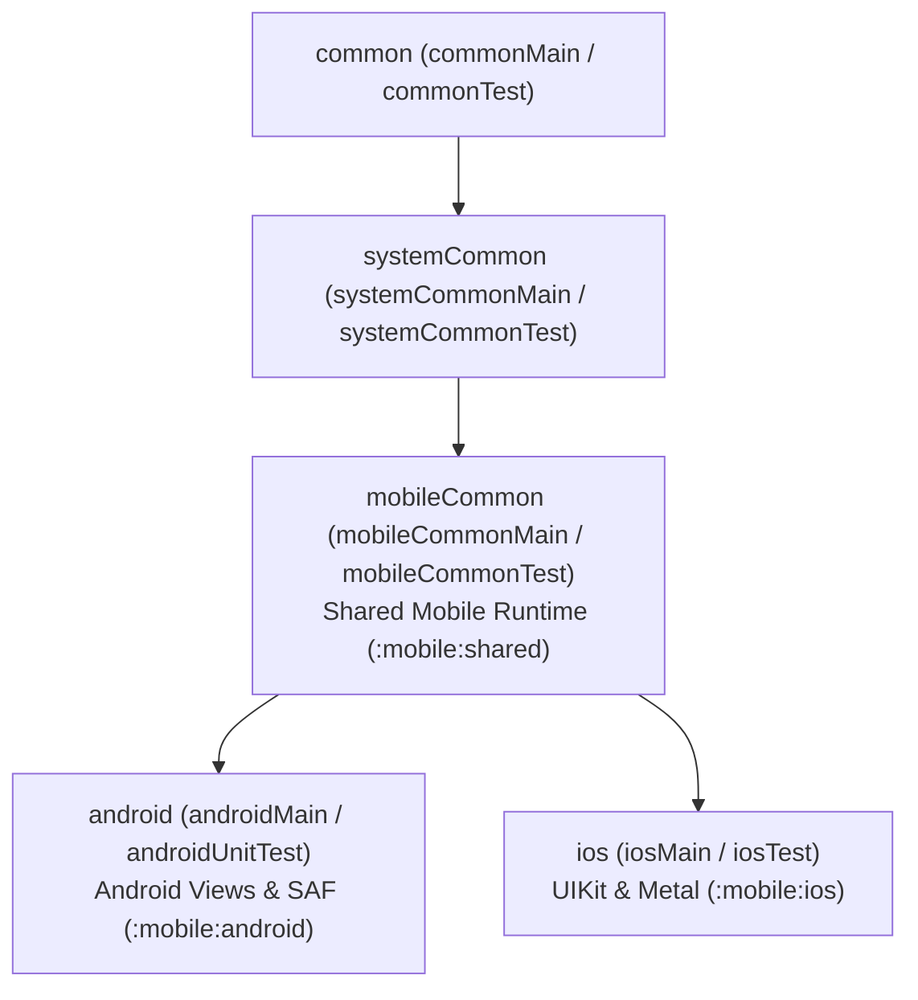

# GenericUI — Mobile Submodule (`:mobile`)

> **Root Repository**: [**GenericUI (`../README.md`)**](../README.md) | **Root Documentation**: [SourceSet Hierarchy](../docs/sourcesets.md) · [Backends Guide](../docs/backends.md) · [Extensions Guide](../docs/extensions.md) · [Gradle Plugin](../docs/gradle-plugin.md) · [UI Testing](../docs/testing.md)

The **Mobile Submodule (`:mobile`)** of **GenericUI** (`com.nexustools.genericui`) provides the shared mobile layout, posture, gesture, lifecycle, Picture-in-Picture, document picker, and lazy viewport engine (`:mobile:shared`), together with the native **Android** (`:mobile:android`) and **iOS** (`:mobile:ios`) platform backends.

---

## Submodule Architecture & Categorized Modules

| Gradle Module | Directory | Target Platforms | SourceSet Tier | Responsibility & Native Backing | Detailed Guide |
| :--- | :--- | :--- | :--- | :--- | :--- |
| **`:mobile:shared`** | [`shared/`](./shared) | `android`, `iosArm64`, `iosSimulatorArm64` | `mobileCommon` (`mobileCommonMain` / `mobileCommonTest`) | Shared mobile adaptive form-factor & foldable posture coordinator (`MobileDeviceFormFactor`, `MobileOrientationPosture`, `MobileAdaptiveFragmentCoordinator`), safe-area/cutout/IME inset tracker (`MobileSafeAreaTracker`), multi-touch gesture recognizer & fling physics (`MobileGestureRecognizer`, `MobileFlingPhysics`, `MobileHapticFeedbackType`), lifecycle & PiP bridges (`MobileLifecycleBridge`, `MobilePipController`), document picker bridge (`MobileDocumentPickerBridge`), and memory-pressure-aware lazy viewport recycling (`MobileLazyViewportPool`). | [**`docs/shared.md`**](./docs/shared.md) |
| **`:mobile:android`** | [`android/`](./android) | `android` (API 24+) | `android` (`androidMain` / `androidUnitTest`) | Native Android Views (`AndroidNativeFactory`), 1:1 Android `Activity`-compatible `GenericUiFragmentActivity` (`AppCompatActivity` + `Fragment.setNavBar` $\rightarrow$ `MaterialToolbar` + `BottomNavigationView`), Storage Access Framework file/folder picker (`AndroidFileBrowserDialogImpl` via `ACTION_OPEN_DOCUMENT`, `ACTION_CREATE_DOCUMENT`, `ACTION_OPEN_DOCUMENT_TREE`), `RecyclerView` + `MobileLazyViewportPool` true lazy views, `BitmapFactory`/`ImageDecoder` codec, and Vulkan / EGL GLES3 canvases. | [**`docs/android.md`**](./docs/android.md) |
| **`:mobile:ios`** | [`ios/`](./ios) | `iosArm64`, `iosSimulatorArm64` | `ios` (`iosMain` / `iosTest`) | Native Apple UIKit (`IosNativeFactory`, `UIWindow`, `UIViewController`, `UIScene`, `UINavigationBar`, `UITabBar`, `UIView`), `CADisplayLink` VBlank-synchronized `registerVBlankRender` with `deltaMs`, `UIDocumentPickerViewController` file & folder browser (`UTTypeFolder`), `MobileLazyViewportPool` true lazy views, CoreGraphics `Canvas2D`, and `MoltenVK` Metal `VKCanvas`. | [**`docs/ios.md`**](./docs/ios.md) |

---

## Hierarchical SourceSet Integration (`systemCommon` $\rightarrow$ `mobileCommon` $\rightarrow$ `android` / `ios`)

When you enable `android()` and/or `ios()` in `genericui { backends { ... } }`, the GenericUI Gradle plugin automatically constructs the mobile branch of the sourceSet hierarchy:



| SourceSet Node | Main & Test Directories | Included Mobile Backends | Typical Use Cases |
| :--- | :--- | :--- | :--- |
| **`common`** | `src/commonMain`, `src/commonTest` | All 8 GenericUI Backends (`:desktop:*`, `:mobile:*`, `:web`) | Shared UI components, `Fragment`s, `AdaptiveSplitTabFragment`, `TitleBar`, and domain logic. |
| **`systemCommon`** | `src/systemCommonMain`, `src/systemCommonTest` | `:desktop:*` + `:mobile:*` (excludes `:web`) | Native filesystem access, sockets, hardware capabilities, and local persistence. |
| **`mobileCommon`** | `src/mobileCommonMain`, `src/mobileCommonTest` | `:mobile:android`, `:mobile:ios` (backed by `:mobile:shared`) | Multi-touch gestures, safe-area inset layouts, foldable posture adaptation, PiP, and mobile haptics. |
| **`android`** | `src/androidMain`, `src/androidUnitTest` | `:mobile:android` | `GenericUiFragmentActivity` subclasses, Android `Intent`s, Services, and Android-specific SDK APIs. |
| **`ios`** | `src/iosMain`, `src/iosTest` | `:mobile:ios` | UIKit `UIViewController` hosting, Objective-C/Swift interop, and Apple framework integrations. |

For the complete cross-platform sourceSet hierarchy, see [**Root SourceSet Hierarchy (`../docs/sourcesets.md`)**](../docs/sourcesets.md).

---

## Configuring Mobile Backends in `build.gradle.kts`

```kotlin
plugins {
    kotlin("multiplatform")
    id("com.nexustools.genericui")
}

genericui {
    backends {
        // Enable both :mobile:android and :mobile:ios together:
        allMobile()

        // Or configure individually:
        android()
        ios()
    }

    application {
        appName = "Episode Caster"
        appId = "com.nexustools.episodecaster"
        version = "1.0.0"
        commonIcon("src/commonMain/resources/icons/icon.png")
    }

    graphics {
        bundleMoltenVkOnApple = true // Enables Vulkan 1.2 -> Apple Metal via MoltenVK on iOS
        preferOpenGLES31 = true      // Uses EGL / OpenGL ES 3.1 on Android for GLCanvas
    }

    extensions {
        canvas2d() // Android Canvas / CoreGraphics 2D rendering
        canvas3d() // Vulkan (VKCanvas) & OpenGL ES (GLCanvas)
        media()    // Hardware-accelerated mobile VideoPlayer, AudioPlayer, and AudioAnalyzer
        webView()  // Uses native android.webkit.WebView on Android and WKWebView on iOS (never NJS)
    }
}
```

### Mobile Gradle Tasks

| Backend | Development Build / Run Task | Production Build / Package Task | UI Test Task |
| :--- | :--- | :--- | :--- |
| **`:mobile:android`** | `./gradlew androidDevelopment` | `./gradlew androidProduction` | `./gradlew testDebugUnitTest` (`AndroidRobolectricRunnerNativeImpl`) |
| **`:mobile:ios`** | `./gradlew iosDevelopment` | `./gradlew iosProduction` | `./gradlew iosSimulatorArm64Test` (`IosJestElectricRunnerNativeImpl`) |

---

## Mobile Documentation Guides (`mobile/docs/*.md`)

1. [**Shared Mobile Runtime (`:mobile:shared`)**](./docs/shared.md) — `MobileDeviceFormFactor`, `MobileOrientationPosture`, `MobileSafeAreaTracker`, `MobileAdaptiveFragmentCoordinator`, `MobileGestureRecognizer`, `MobileFlingPhysics`, `MobileHapticFeedbackType`, `MobileLifecycleBridge`, `MobilePipController`, `MobileDocumentPickerBridge`, and `MobileLazyViewportPool`.
2. [**Android Backend (`:mobile:android`)**](./docs/android.md) — `AndroidNativeFactory`, `GenericUiFragmentActivity` 1:1 Android `Activity` compatibility, `Fragment.setNavBar` $\rightarrow$ `MaterialToolbar`, `RecyclerView` + `MobileLazyViewportPool` true lazy loading/unloading, `AndroidFileBrowserDialogImpl` via `ACTION_OPEN_DOCUMENT` / `ACTION_CREATE_DOCUMENT` / `ACTION_OPEN_DOCUMENT_TREE`, and Vulkan & EGL/GLES3 canvases.
3. [**iOS UIKit Backend (`:mobile:ios`)**](./docs/ios.md) — `IosNativeFactory`, UIKit `UIViewController` / `UIScene`, `CADisplayLink` `registerVBlankRender` with `deltaMs`, `UIDocumentPickerViewController` file/folder browser, `MobileLazyViewportPool`, CoreGraphics `Canvas2D`, and `MoltenVK` Metal `VKCanvas`.

---

## Cross-References to Sibling Submodules & Root Docs

- **Root GenericUI Repository**: [`../README.md`](../README.md)
- **Root Architecture & Guides**:
  - [SourceSet Hierarchy (`../docs/sourcesets.md`)](../docs/sourcesets.md)
  - [Platform Backends Overview (`../docs/backends.md`)](../docs/backends.md)
  - [Extensions Architecture (`../docs/extensions.md`)](../docs/extensions.md)
  - [Gradle Plugin Reference (`../docs/gradle-plugin.md`)](../docs/gradle-plugin.md)
  - [UI Testing Guide (`../docs/testing.md`)](../docs/testing.md)
- **Sibling Submodules**:
  - **Desktop Backends (`:desktop`)**: [`../desktop/README.md`](../desktop/README.md) ([`:desktop:shared`](../desktop/docs/shared.md), [`:desktop:windows`](../desktop/docs/windows.md), [`:desktop:macos`](../desktop/docs/macos.md), [`:desktop:gtk`](../desktop/docs/gtk.md), [`:desktop:qt`](../desktop/docs/qt.md), [`:desktop:swing`](../desktop/docs/swing.md))
  - **Web Backend (`:web`)**: [`../web/README.md`](../web/README.md) ([Web Backend](../web/docs/web-backend.md), [Wasm/JS Loader & Splash](../web/docs/wasm-js-loader-and-splash.md))
  - **UI Testing Suite (`:tests` / `JestElectricRunner`)**: [`../tests/README.md`](../tests/README.md) ([`JestElectricRunner` Guide](../tests/docs/jest-electric-runner.md), [Platform Test Runners](../tests/docs/platform-test-runners.md))
  - **Nexus JavaScript Engine (`:NJS` — Desktop Only)**: [`../NJS/README.md`](../lib/NJS/README.md)
